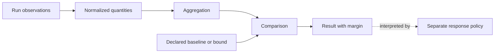

# Measurement

Use this skill to answer:

> How much correct, durable work does an agent produce, at what reconstruction
> and human-attention cost, and how does it compare with a baseline or declared bound?

Turn run observations into reproducible quantities. Define each quantity's unit,
scope, time window, filters, aggregation, and reference before interpreting its value.
Keep every reported result attributable to its source observations.

## Core rule

Raw telemetry becomes a measurement only when its meaning and comparison are defined.
Declare baselines, budgets, targets, and tolerances separately from observations.
Preserve missing values as `unknown` and retain the margin behind each conclusion.
Leave warning, adapting, degrading, and gating to a separate response policy.



## How to use this skill

1. **State the engineering question and scope.** Identify the task, run, condition,
   repository revision, and unit of analysis. For the initial MAGE experiment, use
   [MAGE Project Guidance](../../../agent-guidance-docs/PROJECT_GUIDANCE.md) for
   the study contract and unresolved controls.
2. **Choose the measurement chain.** Use the chains below. Prioritize correct and
   accepted completion, then durable throughput, reconstruction cost, and defect escape.
3. **Define the quantity before calculating it.** Record its semantics, provenance,
   missing-data policy, and separately declared reference using the executable
   record contract below.
   For rates, state the denominator; for composites, use only approved weights.
4. **Validate the evidence and comparison.** Check the invariants and validation
   criteria below. If required evidence is unavailable or the definitions differ,
   report `unknown` or `not_comparable`.
5. **Calculate and report the result.** Preserve the observed value, reference,
   delta, margin, uncertainty where available, and evidence references. Report
   missingness and comparability limits alongside the conclusion.

## Measurement chains

Choose the chain that answers the engineering question. Keep the chains distinct;
do not collapse them into one score.

| Chain | Source observations | Derived quantity | Reference | Interpretation |
| --- | --- | --- | --- | --- |
| Correctness and acceptance | Task result, test results, benchmark verdict, reviewer acceptance | Completion or acceptance rate | Task acceptance criteria; baseline condition | Whether the treatment preserves or improves correct completion |
| Durable throughput | Landed changes, retained generated code, rework, churn, corrective patches | Retained work per run; rework rate | Baseline distribution or declared tolerance | Whether output survives review and later correction |
| Reconstruction cost | Files read, searches, repeated reads, navigation calls, input tokens, time to first implementation | Reconstruction actions or cost per accepted task | Baseline distribution | Whether explicit models reduce repeated recovery of repository facts |
| Defect escape | Regressions, reopened tasks, architecture violations, policy violations, late failures | Escaped defects or violations per accepted task | Zero where the acceptance contract requires none; otherwise a declared tolerance | Whether apparent efficiency hides lower quality |
| Human-attention burden | Interventions, clarifications, review time, manual corrections, rejected or redirected outputs | Human minutes or interventions per accepted task | Baseline distribution | Whether the treatment reduces work transferred to people |
| Efficiency | Wall-clock time, latency, total tokens, tool calls, attempts, iterations | Resource use per accepted task | Baseline distribution or resource budget | Whether an accepted result consumes fewer resources |
| Bootstrap cost and quality | Bootstrap time and tokens, human corrections, extraction errors, useful coverage, stale facts | Up-front cost; extraction precision and coverage | Declared bootstrap budget and quality thresholds | Whether the reusable models repay their construction cost |

Correct and accepted completion is the primary outcome.
Durable throughput, reconstruction cost, and defect escape follow in that order.
Token or time savings do not establish success when correctness declines.

## Executable measurement model

The implemented mix is **JSON Schema plus deterministic Python checks**:

- [The bundle schema](schemas/bundle.schema.json) defines quantity definitions,
  observations, separately sourced references, and requested comparisons.
- [The checker](scripts/measure.py) recomputes observations and comparisons, checks
  matched-run controls, and preserves unknowns, missingness, uncertainty, and margins.
- [The record contract](references/record-contract.md) explains supported
  aggregations, units, status meanings, setup, and limits. Read it when producing
  machine-readable records or extending a measure.

The JSON definitions are the reusable model, not merely a container for telemetry:
they declare quantity meaning, scope, filters, windows, denominator, and missing-data
policy. The schema is authoritative for the v1 record shape; Python implements
cross-record and arithmetic checks. Do not maintain a second editable definition
in SysML, UML/OCL, or a Markdown table for this workflow. A later projection into
another modeling tool needs an explicit mapping and correspondence check.

Keep the model card explicit: question, scope and omissions, represented property,
quality attribute, authority, and evidence. Reuse canonical entity/run IDs from
other models. A result or event owned elsewhere is linked, not copied as a new authority.

### Use the implementation

In the MAGE repository, use its shared uv environment. From the repository root,
run the bundled synthetic example:

```bash
uv sync
uv run python .agents/skills/measurement/scripts/measure.py .agents/skills/measurement/examples/four-chains.json
```

For a standalone skill installation, install [requirements.txt](requirements.txt)
into a Python 3.9+ environment and invoke the script with that interpreter.

For actual work, use the project's experiment store; otherwise save a scoped bundle
under `.mage/measurement/<scope-id>/bundle.json`. Keep actual evidence and outputs
outside this skill. The bundled examples have `synthetic: true` and are not benchmark
results or settled experiment thresholds. Label real bundles `synthetic: false`
only when the observations actually come from a run.

The checker writes a JSON report to stdout. Save it to a separate file, then use
`--verify-report <report.json>` to recompute it against the same bundle, schema,
and checker. A saved status alone is never evidence.

Exit codes describe the calculation, not whether a system should be admitted:

- `0`: calculations and comparisons completed, including reported bound violations.
- `1`: evidence is incomplete, controls are unknown, comparisons are incompatible,
  inputs are missing, or no comparison was requested.
- `2`: malformed records, broken references, inconsistent arithmetic, or a changed
  saved report.

Keep outside-bound results visible. Do not install a production gate or change a
response policy as a side effect of measuring.

## Preserve the measurement invariants

1. Compare compatible definitions, canonical units, scopes, windows, filters,
   aggregations, and denominators. In matched experiments, also match repository
   revision, task, harness, foundation model, tool access, limits, and retry policy.
   Equal unknown controls do not establish a match.
2. Declare references separately from observations and cite their authority.
   Missing thresholds remain unknown; never invent a passing bound.
3. Represent unavailable values as the literal `"unknown"`. Zero is a measured
   value, not an encoding of missing or stale evidence. A zero rate denominator
   produces unknown, never zero or infinity.
4. Preserve values, signed deltas, raw margin, uncertainty, and missingness.
   A status does not replace the arithmetic. Unknown uncertainty is not zero.
5. Trace derived values to their inputs, evidence references, and generator version.
   Inspect evidence when the claim depends on its truth; structural validation
   does not authenticate a source or prove its interpretation.
6. Declare a rate's denominator. Do not mix per-run, per-attempted-task, and
   per-accepted-task rates.
7. Keep correctness and acceptance primary. Individual numeric comparisons do not
   establish overall MAGE success, statistical significance, or efficiency gains
   without the study's acceptance evidence.
8. Do not use a weighted reconstruction-cost composite until the team approves
   its weights. The current checker intentionally has no arbitrary formula or
   weighted-sum execution; report its components separately.

## Supported measurement relations

The checker calculates `value`, `sum`, `count`, `count_distinct`, `mean`,
and `ratio`. A ratio uses explicitly labeled numerator and denominator inputs.
Use that mechanism for acceptance, rework, defect escape, retained-work rates,
human minutes per task, or resource use per accepted task; define each quantity's
own units and denominator. Unsupported aggregations require a deliberate extension,
not an inferred formula.

The synthetic [four-chain example](examples/four-chains.json) covers accepted
completion, rework, reconstruction, and escaped defects. The
[budget example](examples/budget.json) shows a bound violation with a preserved
negative margin. The [tests](tests/test_measure.py) exercise valid calculations,
missing evidence, mismatched comparisons, and altered saved reports.

## Initial MAGE experiment

The repository revision, task set, agent harness, foundation model, tool access, resource limits, retry policy, and numeric success thresholds remain open decisions in the project guidance.
Define their required fields, but do not fill them with inferred values. Check the
current project guidance for declared decisions before running a comparison.

For the first fixture, select one measure from each of the four primary outcome groups:

1. accepted completion;
2. retained work or rework;
3. one direct reconstruction observation, such as distinct files read before the first implementation edit;
4. escaped defects or rule violations.

Add human-attention, efficiency, and bootstrap measures after the event schema can collect them consistently.

## Deliverable

For a measurement-design task, provide the quantity definitions, required evidence,
declared references, and unresolved fields. For an analysis task, provide comparison
records and a concise interpretation with missingness and comparability limits.
For a validation task, identify invalid records and the fields or evidence needed
to repair them. Match the deliverable to the user's request; defining a measure
does not authorize changing an enforcement policy.

## Sources

- [*Model-Based Agentic Software Engineering*](../../../agent-guidance-docs/mage-book-2.pdf), Chapter 2, Section 2.6, pages 76-79: quantities, relations, separately declared bounds, tolerance, margin, and the separation of measurement from enforcement. Consult it when interpreting the model's conceptual basis.
- [MAGE Project Guidance](../../../agent-guidance-docs/PROJECT_GUIDANCE.md): shared metadata, experimental measures, priority order, unresolved controls, and explicit missing values. Consult it when applying this skill to the initial experiment.
